<p align="center">
  
</p>

<h1 align="center">Pipetrace</h1>

<p align="center">
  <strong>Turn a water system's lead service line spreadsheet into an address lookup, a map and a plain-language guide that residents can actually use.</strong><br>
  English and Spanish · free map with no tile fees · runs on a small server or as a free static site
</p>

<p align="center">
  <a href="https://github.com/lobojoel2003/Pipetrace/actions/workflows/ci.yml"></a>
  <a href="https://github.com/lobojoel2003/Pipetrace/releases/latest"></a>
  <a href="LICENSE"></a>
  
  
</p>

<p align="center">
  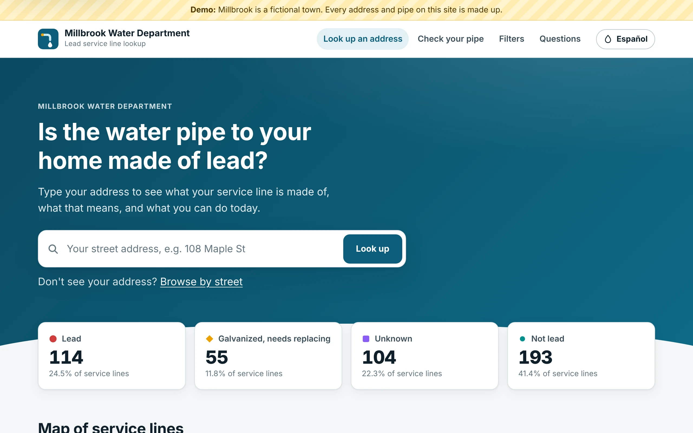
</p>

> The screenshots show **Millbrook**, a fictional town that ships with Pipetrace as demo
> data. Every address and pipe in it is made up.

## Why

Every U.S. community water system had to list every service line it owns, say whether
each one is lead, and make that list public.

* EPA estimates there are **9.2 million lead service lines** in the U.S., about 9% of
  all service lines ([ASCE](https://www.asce.org/publications-and-news/civil-engineering-source/civil-engineering-magazine/article/2024/01/us-epa-proposes-10-year-deadline-to-remove-lead-service-lines)).
* The rule covers about **50,000 community water systems**. Initial inventories were
  due **October 16, 2024**, and every lead line must be replaced by **November 1, 2037**
  ([National League of Cities](https://www.nlc.org/lead)).
* Replacing them could cost **more than $90 billion**, over $10,000 per line (ASCE,
  quoting the American Water Works Association), so small systems have little left for
  software.

Big cities bought mapping products to publish their inventories. Small systems often
have a spreadsheet nobody can search, so residents can't find out whether their own
pipe is lead. Commercial tools ([120Water](https://120water.com/solutions/),
[BlueConduit](https://www.wateronline.com/doc/blueconduit-launches-new-software-to-locate-and-replace-lead-service-lines-0001),
Esri templates) are paid. Pipetrace is free and open source.

## What residents get

**One plain answer, in a colour and a shape.** A resident types an address and sees
whether the line is **lead**, **galvanized requiring replacement**, **not lead**, or
**unknown**, what that means, what to do today, and when it will be replaced.

<p align="center">
  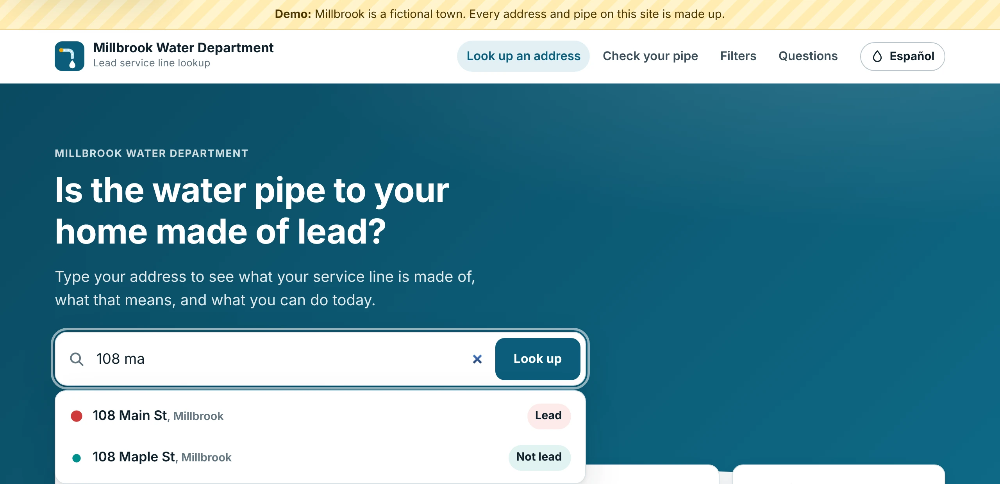
  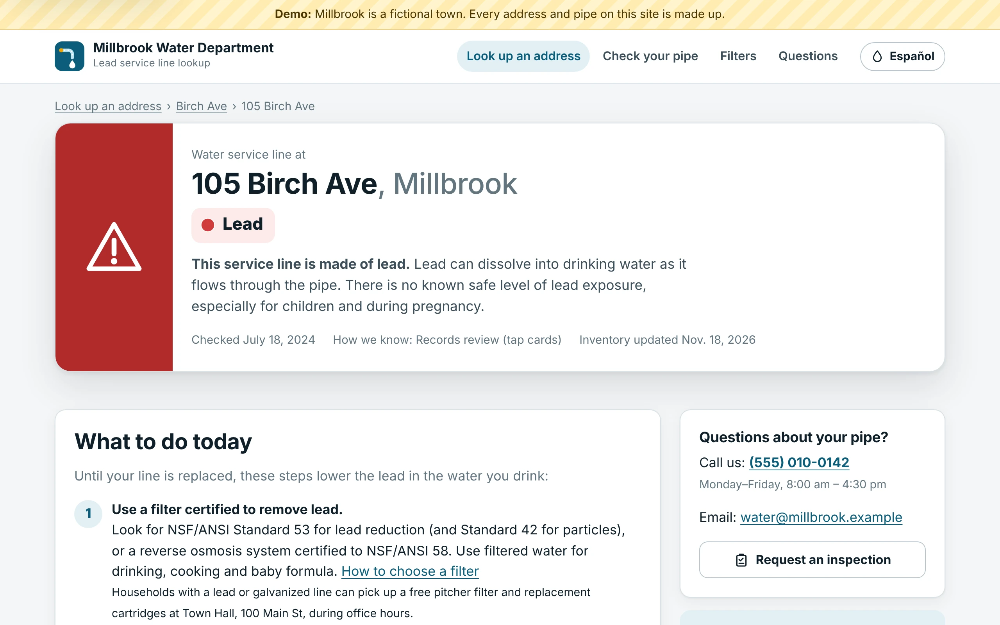
</p>

**"Unknown" comes with a way to find out.** A two-minute guide shows how to check the
pipe with a coin and a magnet, with illustrations and a "what did you find?" helper, and
a form to send the photo to the utility. Photos are re-encoded to strip GPS data and
are only visible to staff.

<p align="center">
  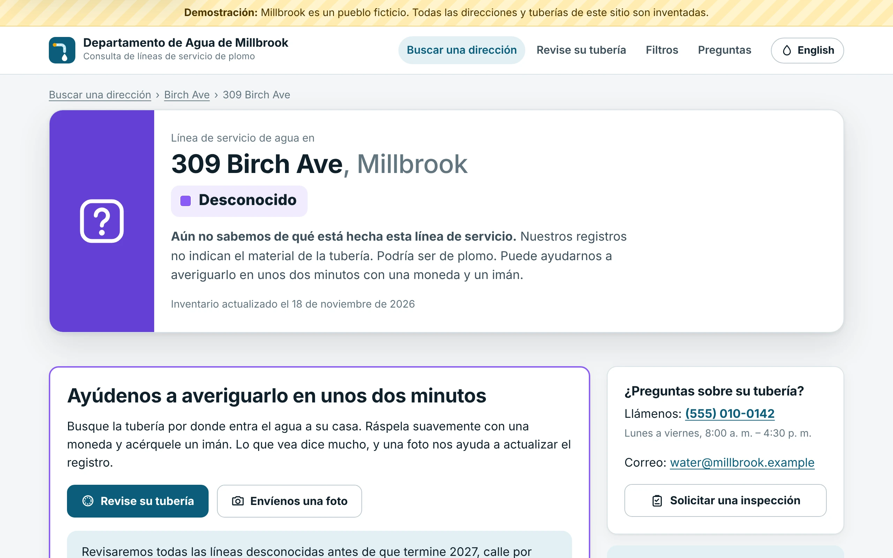
  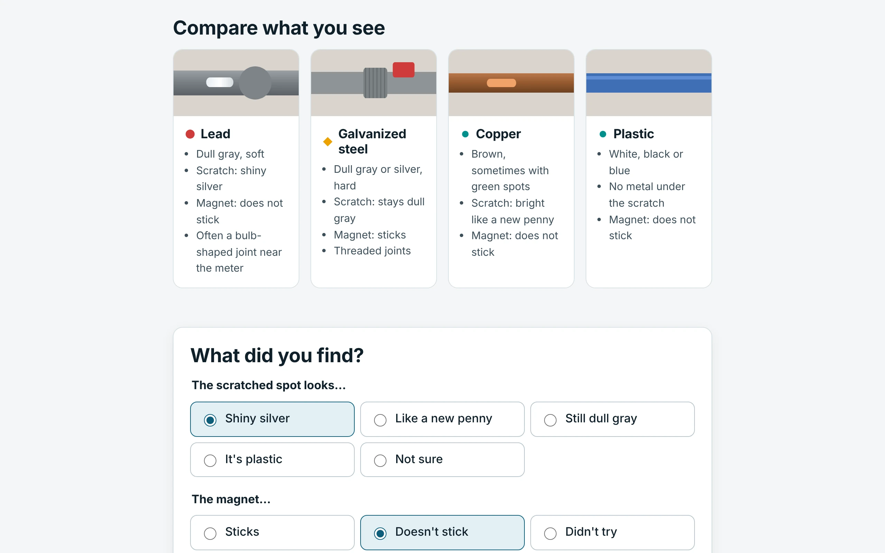
</p>

**A map without map fees.** MapLibre GL draws every line over a self-hosted
[Protomaps](https://protomaps.com) basemap: one `.pmtiles` file, no API key, no tile
bill. Status colours were checked for colour-blind readers and each status also has its
own marker shape, in light and dark themes.

<p align="center">
  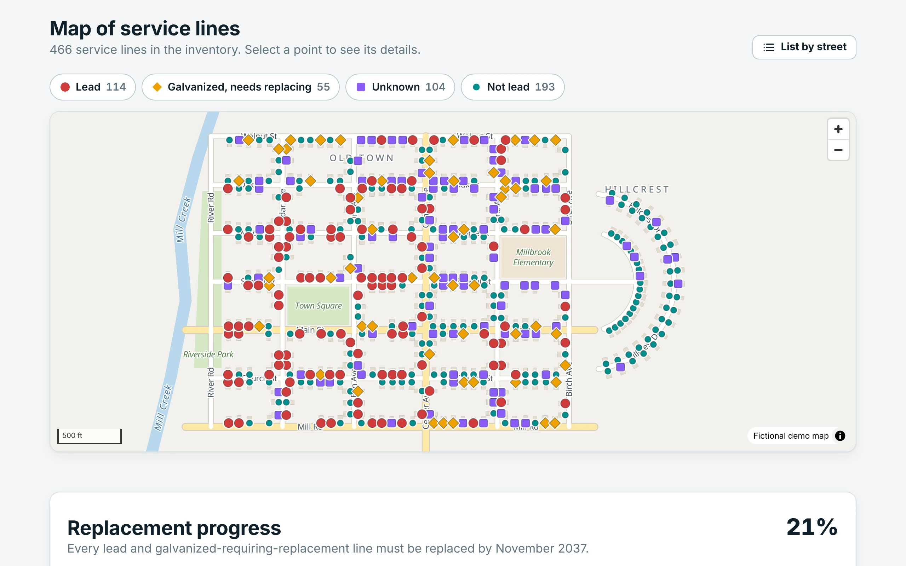
  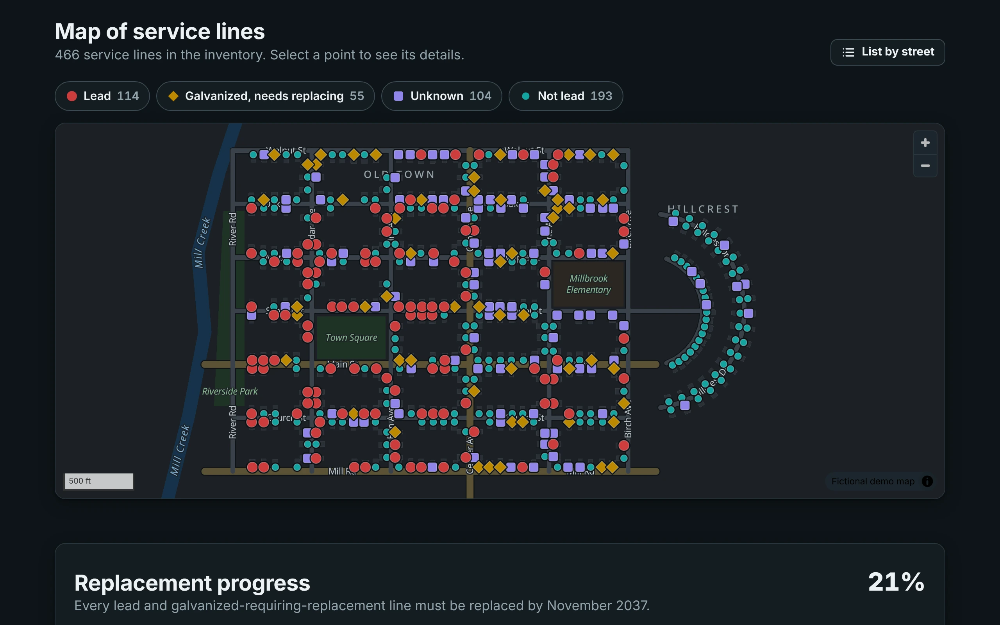
</p>

And everything else a resident needs:

* **English and Spanish** on every page, with a one-click switch.
* **Filter advice**: which certification to look for (NSF/ANSI 53, 42, 58) and how to
  use it, plus the utility's own filter program.
* **Inspection requests** with the resident's preferred contact method and language.
* **Browse by street** for anyone who can't or won't use search or the map.
* Works on phones and prints cleanly. Text is high-contrast, and status is never shown
  by colour alone.

<p align="center">
  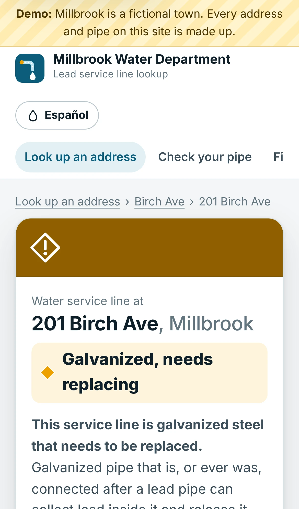
</p>

## What staff get

**Upload the spreadsheet you already have.** The importer reads EPA-template and
home-grown `.xlsx`/`.csv` files. It finds the header row under titles and two-row group
headers ("System-Owned Portion › Material"), guesses every column, and shows a
column-mapping screen for anything messy.

<p align="center">
  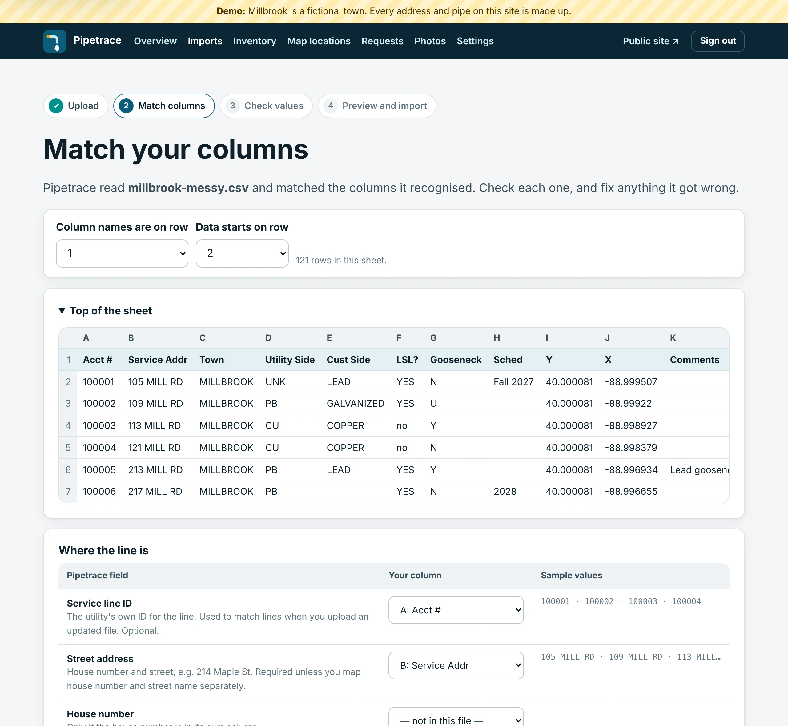
  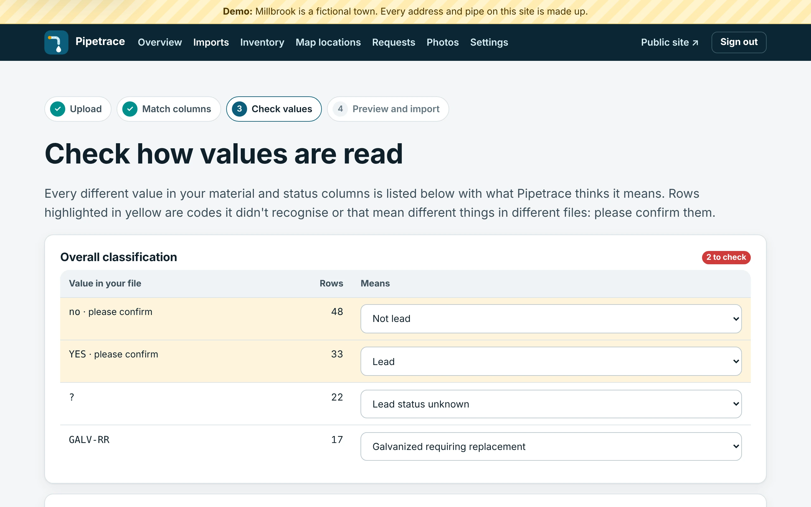
</p>

* **Every code is checked.** `Pb`, `LSL`, `L` → lead; `Cu`, `NL - Copper` → copper;
  `GRR`, `GALV-RR` → galvanized requiring replacement; `U`, `UNK`, `?` → unknown.
  Ambiguous codes are highlighted for a person to confirm.
* **Preview before import**: lines added, updated, unchanged and hidden; rows with
  errors; and lines whose stated classification contradicts their materials.
* **Classification rules** from the Lead and Copper Rule Improvements when the file
  only has the two portions' materials.
* **Geocoding** with the free U.S. Census Bureau geocoder or your own Pelias server.
* **Requests and photos** in one place. Reviewing a photo can update the inventory in
  one click.
* **CSV export** with EPA-style columns, and a **one-click static site** download.

<p align="center">
  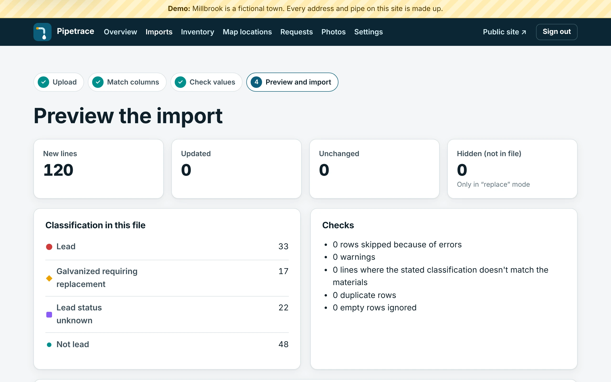
  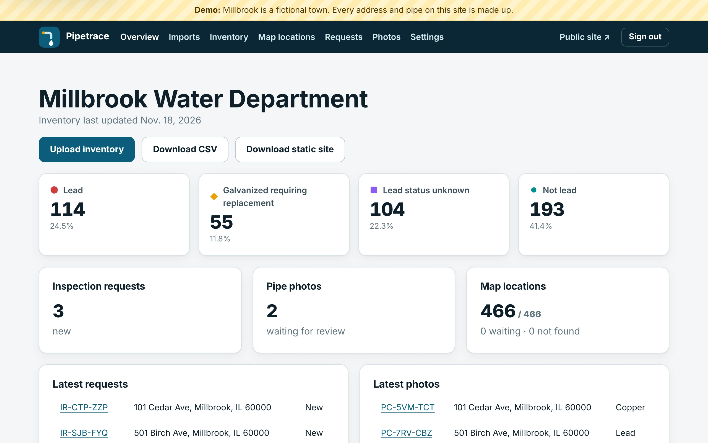
</p>

## Try it

With Docker:

```bash
git clone https://github.com/lobojoel2003/Pipetrace.git
```

```bash
cd Pipetrace && docker compose up -d --build
```

Open <http://localhost:8000> for the resident site (with the Millbrook demo) and
<http://localhost:8000/staff/> for the staff area (user `admin`, password
`change-me-admin-password`; change both before going live).

Or download `pipetrace-<version>-demo-site.zip` from the
[latest release](https://github.com/lobojoel2003/Pipetrace/releases/latest), unzip it
and serve the folder with any web server, e.g. `python -m http.server`.

## Deploy it

| You have | Use |
| --- | --- |
| A small Linux server or cloud VM | [Docker Compose with HTTPS](docs/deploying.md) |
| Python hosting, no Docker | [Install the wheel](docs/deploying.md#option-2-without-docker) |
| No server at all | [Static export](docs/static-hosting.md) to GitHub Pages, Netlify or your town's website |

Then:

1. Fill in your utility's details and programs under **Settings**
   ([configuration](docs/configuration.md)).
2. [Import your inventory](docs/importing.md).
3. Optionally [add a free basemap](docs/basemap.md) of your service area.

## How it's built

* **Django 5.2 LTS + PostGIS** for the inventory, search (trigram + address
  normalisation to USPS abbreviations) and the staff tools.
* **openpyxl** for spreadsheets; the importer lives in
  [`pipetrace/inventory/importer/`](pipetrace/inventory/importer).
* **MapLibre GL JS + PMTiles + Protomaps basemaps**, vendored (no CDN, no build step).
* **Static export** renders every page through the same views, then searches a compact
  index in the browser with the same scoring as the server.
* Plain CSS and ES modules; no JavaScript framework.

```
pipetrace/
  inventory/   service lines, classification rules, importer, geocoding, search
  residents/   public pages, forms, JSON API
  staff/       dashboard, import wizard, geocoding, request and photo review
  export/      static site exporter
  core/        site settings, security headers, health check
  templates/   pages (English source, Spanish in locale/es)
```

## Development

See [CONTRIBUTING.md](CONTRIBUTING.md). In short:

```bash
pip install -r requirements/dev.txt && pip install --no-deps -e .
PIPETRACE_DEBUG=1 python manage.py migrate && PIPETRACE_DEBUG=1 python manage.py load_demo
PIPETRACE_DEBUG=1 python manage.py runserver
```

```bash
ruff check . && pytest
```

The test suite runs against PostGIS and covers the classification rules, the importer
(EPA layout, messy headers, value codes, merge and replace), geocoder parsing, every
page in both languages, the staff wizard end to end, the static export, and browser
tests of the exported site.

## Versions, builds and releases

Pipetrace follows [Semantic Versioning](https://semver.org). Every CI run has a build
number, and every build shows its full version, such as `1.0.0+build.42.3f9a2b1`, in
the page footer, at `/healthz` and in the container labels.

After [`scripts/release.py`](scripts/release.py) bumps the version, pushing the tag
`vX.Y.Z`, or running the [Release workflow](.github/workflows/release.yml) from the
Actions tab with the version number, runs the tests and then publishes a GitHub Release named
"Pipetrace X.Y.Z (build N)" with notes from the [changelog](CHANGELOG.md), the wheel
and source archive, the demo static site, SHA-256 checksums, and multi-arch images at
`ghcr.io/lobojoel2003/pipetrace:X.Y.Z`.

| Workflow | Runs on | Does |
| --- | --- | --- |
| [CI](.github/workflows/ci.yml) | every push and pull request | lint, tests on Python 3.12 and 3.13 with PostGIS, browser tests, Docker build and smoke test; publishes `:edge` from `main` |
| [Release](.github/workflows/release.yml) | tags `v*`, or manually with a version | everything above, then the tag, the release and the images |
| [Demo site](.github/workflows/pages.yml) | pushes to `main` | publishes the Millbrook demo to GitHub Pages (once Pages is turned on with "GitHub Actions" as the source) |

## Good to know

* Pipetrace shows what the utility's records say. Records can be wrong, and the site
  says so and invites corrections.
* The health guidance (filters, flushing, cold water, blood tests) is general advice
  in line with EPA's public guidance. Utilities can add their own programs in
  Settings and should review the text with their state regulator.
* Pipetrace is not legal or compliance advice. Check your state's inventory and
  notification requirements.

## License

[GNU Affero General Public License v3.0 or later](LICENSE). Map libraries and fonts
keep their own licences (BSD-3-Clause, SIL OFL, MIT); see
[VENDORED.md](pipetrace/static/pipetrace/vendor/VENDORED.md). Map data ©
[OpenStreetMap](https://www.openstreetmap.org/copyright) contributors.
